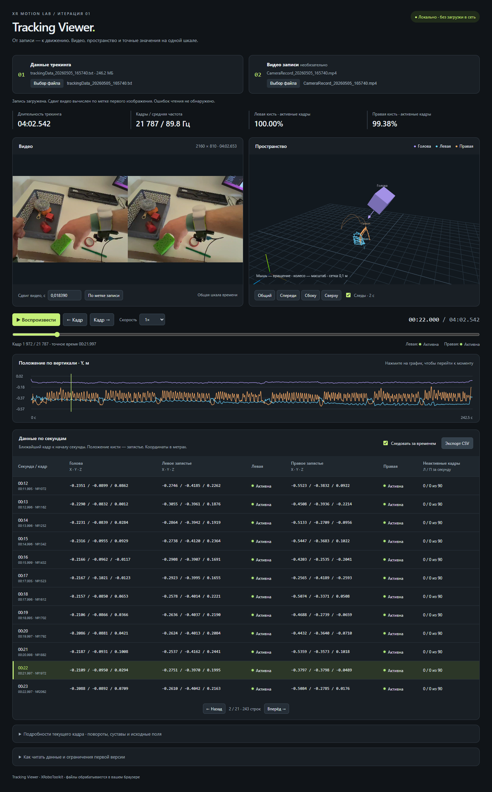

# Tracking Viewer

Локальный просмотрщик записи XRoboToolkit: видео рядом с 3D-головой и кистями, общая перемотка, график и таблица по секундам.

## Запуск

1. Скачайте **всю папку проекта**, включая `vendor`.
2. Откройте `index.html` двойным щелчком в актуальном Microsoft Edge или Google Chrome.
3. В «Данные трекинга» выберите `trackingData_20260505_165740.txt`.
4. При желании выберите `CameraRecord_20260505_165740.mp4` в блоке видео.
5. Дождитесь чтения трекинга и нажмите «Воспроизвести».

Установка, сервер, сборка и интернет **не требуются**. Исходные файлы выбираются через браузер и никуда не отправляются. После обновления страницы их нужно выбрать заново. Видео должно поддерживаться браузером (рекомендуется MP4/H.264). На слабом компьютере чтение большого TXT может занять некоторое время.

## Управление

- Общая шкала: пауза и переход к моменту. Кнопки «Кадр» переключают исходные измерения.
- Скорости: 0,25×, 0,5×, 1×, 2×.
- 3D: потянуть мышью — вращение; колесо — масштаб; кнопки задают общий, передний, боковой и верхний ракурсы.
- Голова обозначена условным шлемом, кисти — 26 суставами каждая. Цвета: фиолетовый / голубой / оранжевый.
- Следы показывают движение запястий за последние две секунды. Они обрываются при невалидном трекинге.
- График показывает исходную координату Y головы и запястий. Нажатие на график перематывает запись.
- Таблица: одна строка на секунду, ближайший кадр к её началу. Точное время кадра написано под секундой. Нажатие на время перематывает запись.
- «Следовать за временем» автоматически переключает страницы таблицы. Листание вручную отключает этот режим.
- «Подробности текущего кадра»: координаты суставов, их флаги, кватернион головы. «Прочитать исходный кадр» показывает все поля исходной строки, включая Body, радиусы и ориентации суставов.
- «Экспорт CSV» сохраняет таблицу по секундам. Разделитель — запятая, десятичный разделитель — точка; кодировка UTF-8 с BOM.

## Синхронизация

Время трекинга отсчитывается от первого принятого кадра. Если начальная строка содержит время первого изображения, сдвиг вычисляется как:

`сдвиг = (метка первого кадра трекинга − метка первого изображения) / 1e9`

`время видео = время трекинга + сдвиг`

Для предоставленной записи начальный сдвиг равен **+0,018389760 с**. Это исходная привязка, не гарантия совпадения с моментом экспозиции каждого видеокадра. Визуально проверьте заметное движение. В поле сдвига можно ввести поправку; кнопка «По метке записи» восстанавливает вычисленное значение.

Во время совместного воспроизведения используется время видео: при буферизации или поиске кадра скелет не убегает вперёд. Вне диапазона видео трекинг идёт по собственной шкале, поверх остановленного видео появляется подпись. Без видео вся анимация работает самостоятельно. Видеозвук в первой версии отключён.

## Формат и принятые решения

Вход — JSON Lines: одна JSON-запись на строку. Поза — `x,y,z,qx,qy,qz,qw`.

**Особенность записи:** сериализатор использует локальные десятичные запятые вместе с запятыми-разделителями. В предоставленном файле позы головы и кистей записаны как 14 фрагментов, которые однозначно группируются в 7 пар. Парсер поддерживает этот вариант, стандартные 7 чисел с десятичными точками и массивы из 7 чисел. Смешанные неоднозначные строки не угадываются: поза помечается отсутствующей, счётчик виден в диагностике.

Большие `timeStampNs` извлекаются как строки и вычитаются через `BigInt`, чтобы не терять точность наносекунд. Файл читается блоками по 1 МиБ, UI показывает прогресс и позволяет отменить чтение. В памяти остаются компактные позы, флаги и смещения исходных строк, а не весь разобранный Body. Исходная строка читается из файла по требованию. Дубликаты и обратные метки времени пропускаются и явно учитываются в диагностике. Неверный JSON и время также учитываются.

Кисти используют порядок `PXR_HandTracking.HandJoint`: ладонь 0, запястье 1, затем пять цепочек пальцев. `isActive` отображается отдельной лампочкой. Для показа точки дополнительно необходим флаг `PositionValid` (бит 2) и конечные координаты. Поле `s` — битовая маска, **не** оценка точности: 1 — orientation valid, 2 — position valid, 4 — orientation tracked, 8 — position tracked. Значение 15 включает все четыре флага. При отсутствии данных лампочка серая, координаты — прочерки. SDK описывает `isActive` как уровень активности/качества; индикатор не означает измеренную погрешность.

Для головы показывается исходный `status`, не делается неподтверждённая расшифровка его битов. Статус 0 скрывает модель головы. Кватернион нормализуется для отрисовки. Позиции не сглаживаются и не интерполируются: всегда выбирается ближайший исходный кадр. Запястье в таблице — точка 1, не усреднённая кисть. Секундная статистика считается по всем кадрам в интервале `[секунда, секунда + 1)`; последняя секунда может быть неполной.

Координаты остаются в исходной системе SDK, X вправо и Y вверх; для отображения используется правая система Three.js без зеркального преобразования. Положение сетки выбирается ниже траекторий; она **не** обозначает измеренный пол. Размер условного шлема декоративный. Направление головы не равно направлению взгляда глаз.

## Наблюдения по предоставленной записи

- 21 787 кадров трекинга, длительность между первым и последним: 242,542289152 с.
- Медианный интервал: 11,122176 мс, средняя частота около 89,8 Гц.
- У левой кисти `isActive=1` во всех кадрах; у правой 135 кадров с `isActive=0`.
- По 26 суставов в каждой кисти. В неактивных кадрах правой кисти их флаги равны 0, поэтому эти координаты не визуализируются как достоверные.
- Присутствует Body с 24 элементами. В его дополнительных полях встречаются аномальные величины. В первой версии Body доступен в исходном кадре, но не используется в анимации.

Это технические наблюдения о записи, не выводы о качестве движений человека. Наложение на видео, калибровка камер, полное тело и расчёт скоростей не входят в первую итерацию.

## Структура

| Файл | Назначение |
|---|---|
| `index.html` | Интерфейс |
| `styles.css` | Оформление и адаптация к размеру экрана |
| `parser.js` | Чтение, проверка, время, секундные интервалы |
| `scene.js` | 3D-скелеты, шлем, следы, управление камерой |
| `app.js` | Воспроизведение, видео, таблица, график, экспорт |
| `vendor/` | Локальная Three.js 0.160.1 и MIT-лицензия |
| `tests/parser.test.cjs` | Проверки формата, временных меток и ошибок |

Проверки парсера (только для разработки, Node.js 18+): `node tests/parser.test.cjs`.

## Источники формата

- [XRoboToolkit TrackingData.cs](https://github.com/XR-Robotics/XRoboToolkit-Unity-Client/blob/main/Assets/Scripts/TrackingData.cs): порядок позы и сериализация полей.
- [PXR_HandTracking.cs](https://github.com/XR-Robotics/XRoboToolkit-Unity-Client/blob/main/PICO%20Unity%20Integration%20SDK/Runtime/Scripts/Features/PXR_HandTracking.cs): суставы, флаги и радиусы.
- [Three.js](https://threejs.org/): 3D-рендеринг; библиотека включена локально с лицензией.

Перед публичной сдачей добавьте демонстрационное изображение/видео и убедитесь, что у вас есть разрешение публиковать исходные записи. Сам просмотрщик не публикует и не отправляет данные.
